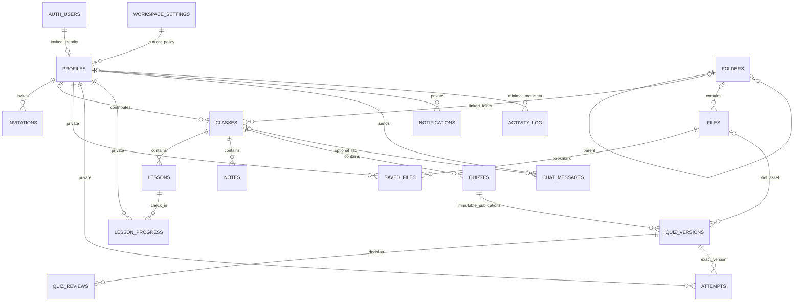

# Architecture and access model

One workspace, one singleton settings row, one shared chat room. React is a client for Supabase; there is no custom backend server. Every table enables RLS and starts closed. Authorization reads current database status, session existence, MFA assurance when enrolled, and policy version on each request. An unexpired JWT alone grants no membership.

## Policy outline

“Approved/current” below means `can_use_workspace()`: approved member, live Auth session, required MFA assurance, and accepted current policy. `is_approved()` and `is_admin()` are explicit SQL helpers. Elevated RPCs are service-only and recheck the acting admin. SECURITY DEFINER functions qualify names, set an empty search path, revoke PUBLIC execution, and grant only required roles.

| Table | Read | Write |
| --- | --- | --- |
| profiles | Own live-session profile; approved admins may list membership | Guarded own-profile/consent/invite RPCs; service-only role/status/deletion; last-admin trigger |
| invitations | Approved/current admins | Service-only reservations/binding/revocation; invite acceptance bound to verified Auth identity |
| workspace_settings | Approved/current members; narrow public policy RPC | Admin Edge action → guarded service RPC; capacity lock, usage validation, policy-change trigger |
| classes | Approved/current group | Member creates with own attribution; owner/admin edits; admin deletes |
| lessons | Approved/current group | Member creates; owner/admin edits; admin deletes; count/byte triggers |
| notes | Approved/current group | Same ownership rules; strict links and size validation |
| folders | Approved/current group | Member create RPC; admin Edge rename/move/delete RPC; cycle/depth and empty-delete checks |
| files | Group-ready vault metadata; own pending/HTML assets; approved admins | Reservation RPC, reserved-path-only Storage insert, Edge validation/adoption/finalization; admin manage RPC |
| saved_files | Owner only | Owner insert/delete, ready vault references only, capacity trigger |
| quizzes | Published metadata, author/admin, or own historical attempt | Guarded versioned save RPC; admin publication/delete actions |
| quiz_versions | Published, author/admin, or owner's exact historical attempt | Guarded save/submit/review RPCs; ever-published content/settings immutable |
| quiz_reviews | Admin or version author | Admin Edge review RPC only |
| attempts | Owner only, including against application admins | Owner published-version recording RPC and strict private import; retention summarizes older details |
| lesson_progress | Owner only, including reflections | Owner progress edits/import/delete |
| chat_messages | Approved/current group | Own sends; DB 20/min trigger and 2,000-character constraint; own/admin delete |
| notifications | Recipient only | DB triggers create; recipient can update read_at or delete |
| activity_log | Approved/current admins | Trusted functions/triggers only; no chat bodies, files, passwords, answers, or reflections |

Storage bucket `cq-vault` is private with a 50 MiB hard object ceiling. Browsers have only INSERT permission for a valid pending reservation path; no raw SELECT/UPDATE/DELETE. An Edge Function checks caller-scoped file/version RLS before issuing a 60-second attachment URL. Finalization validates actual object metadata and HTML, creates an ownerless service copy at a deterministic ready path, removes the original, and commits the ready row. Interrupted work remains pending for retry/cleanup. Maintenance deletes physical objects using Storage APIs before metadata rows; orphan scans exclude both paths of a pending adoption.

Capacity checks take a singleton row lock so concurrent reservations/invites cannot oversubscribe app limits. Retention runs through pg_cron. Object cleanup is a pg_net request to the token-protected maintenance Edge Function. A separate daily external request provides the configured keep-alive.

## Routes and loading

Public: `/setup`, `/login`, `/accept-invite`, `/reset-password`, `/privacy`, `/terms`, `/storage`. Session flows: `/accept-policy`, `/mfa`. Protected: `/`, `/profile`, `/classes`, `/classes/:classId/{lessons,notes,quizzes,files,discussion}`, lesson read/editor routes, `/vault`, `/vault/folders/:folderId`, `/vault/saved`, quiz builder/detail/take routes, `/attempts/:attemptId`, `/progress`, `/chat`, `/notifications`, `/search`, `/admin`.

Every feature route uses React.lazy/Suspense within an error boundary. Markdown, builder question editor, runner, avatar picker, CSV/JSON transfer are lazy. Likely navigation chunks prefetch on hover/focus, with classes after idle time; HTML source never prefetches. Lists paginate on the server: files/learning lists/notifications/admin members 25, chat/activity 50. No rendered list grows indefinitely.

## Browser and runner boundary

App CSP keeps scripts same-origin and denies inline scripts/eval. It permits frames only from the configured runner origin. The outer iframe has only `allow-scripts`; the runner creates a nested Blob iframe with that same restricted sandbox. The runner's response CSP denies default resources/network, permits inline script/style and data images/fonts, allows only Blob child frames, and names the app as frame ancestor. Both framed documents have opaque origins; source-window checks and a fresh channel token bind the reporting protocol. One valid, bounded report is accepted per load. Preview never stores results.

App headers include HSTS, nosniff, strict-origin referrers, disabled camera/mic/geolocation, COOP, and noindex/nofollow. Assets are immutable; entry documents are no-cache. Prepare exact-origin Vercel files before deployment creation and verify actual HTTP responses.

## Build sequence and verification

Schema/RLS/Auth/legal → classes/lessons → vault → seven-type quizzes → runner/HTML → publishing → private progress/import → chat/notifications → admin/backup → performance/caching/accessibility. Tests are layered: pure unit validation/scoring; real Postgres pgTAP; real Storage reservation/ownership checks; fixture-backed React workflows; actual browser CSP isolation and axe. Hosted SMTP, Auth configuration, production headers, operational jobs, and restoration require the launch checklist because credentials were intentionally left blank.
